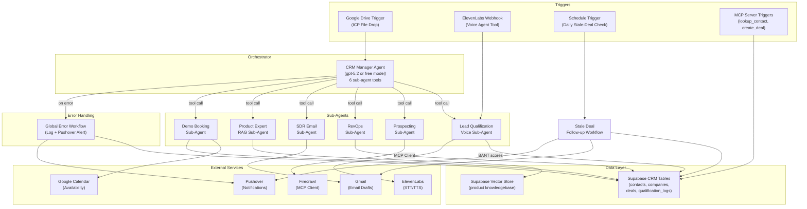

# AccountAI CRM Voice Agent System — Project Plan

> A comprehensive n8n project demonstrating **15 n8n skills** through a multi-agent CRM system with ElevenLabs voice integration, Supabase backend, RAG, MCP, and automated follow-ups.

---

## 🏗️ Architecture Overview



---

## 📋 Skills Checklist (15/16 from the course)

| # | Skill | Where Demonstrated | Workflow |
|---|-------|--------------------|----------|
| 1 | AI Agent nodes with tool-calling loops | CRM Manager orchestrator, every sub-agent | `01-crm-manager.json` |
| 2 | Sub-workflows called as tools (toolWorkflow) | 6 sub-agents wired as tools | All sub-agent JSONs |
| 3 | ElevenLabs voice integration (webhook tools) | Lead Qualification voice agent | `02-lead-qualifier.json` |
| 4 | Structured Output Parser | BANT scores from qualifier, lead data from RevOps | `02-lead-qualifier.json`, `04-revops.json` |
| 5 | RAG with Supabase vector store | Product Expert answers product questions | `06-product-expert-rag.json` |
| 6 | MCP Server Trigger | `lookup_contact` and `create_deal` exposed as MCP tools | `08-mcp-lookup-contact.json`, `09-mcp-create-deal.json` |
| 7 | MCP Client | Prospecting sub-agent consumes Firecrawl MCP | `03-prospecting.json` |
| 8 | Google Drive Trigger | ICP file drop starts the CRM Manager | `01-crm-manager.json` |
| 9 | Google Calendar integration | Demo Booking checks availability + books slots | `07-demo-booker.json` |
| 10 | Gmail integration | SDR drafts outreach emails; Stale-deal follow-ups | `05-sdr.json`, `10-stale-deal-followup.json` |
| 11 | HTTP Request nodes | Firecrawl raw calls, ElevenLabs API, Hunter.io | `03-prospecting.json` |
| 12 | If/Switch branching | BANT score routing (hot/warm/cold), success/failure checks | `01-crm-manager.json`, `02-lead-qualifier.json` |
| 13 | Scheduled triggers (cron) | Daily stale-deal check | `10-stale-deal-followup.json` |
| 14 | Error handling (try/catch + global) | Try/catch per sub-agent + global error workflow | `01-crm-manager.json`, `11-global-error-handler.json` |
| 15 | Context engineering | Optimized prompts, token management, tool descriptions | All agent system prompts |

---

## 📂 Deliverables (File Structure)

```
d:\Dev\N8N\capstone\
├── README.md                          # Setup guide, architecture, skills checklist
├── supabase-schema.sql                # All CRM tables + vector store + functions
├── workflows/
│   ├── 01-crm-manager.json            # Orchestrator (Google Drive Trigger → 6 tools)
│   ├── 02-lead-qualifier.json         # Voice agent (ElevenLabs webhook → BANT → Supabase)
│   ├── 03-prospecting.json            # Firecrawl MCP Client → structured leads
│   ├── 04-revops.json                 # Structured lead → Supabase contacts/companies
│   ├── 05-sdr.json                    # Query contacts → Gmail draft outreach
│   ├── 06-product-expert-rag.json     # Supabase vector retrieval → spoken-friendly answer
│   ├── 07-demo-booker.json            # Google Calendar check → book → create deal
│   ├── 08-mcp-lookup-contact.json     # MCP Server: lookup_contact
│   ├── 09-mcp-create-deal.json        # MCP Server: create_deal
│   ├── 10-stale-deal-followup.json    # Scheduled: stale deals → Gmail drafts → Pushover
│   └── 11-global-error-handler.json   # Error workflow: log to Supabase + Pushover
└── assets/
    └── ICP.pdf                        # Reuse from week3 (symlink or copy)
```

---

## 🗄️ Supabase Schema

### CRM Tables

```sql
-- contacts: leads and customers
CREATE TABLE contacts (
  id UUID PRIMARY KEY DEFAULT gen_random_uuid(),
  name TEXT NOT NULL,
  email TEXT,
  phone TEXT,
  company_id UUID REFERENCES companies(id),
  role TEXT,
  source TEXT CHECK (source IN ('inbound', 'outbound', 'voice', 'mcp')),
  lead_status TEXT DEFAULT 'new' CHECK (lead_status IN ('new', 'qualified', 'nurture', 'cold', 'customer')),
  created_at TIMESTAMPTZ DEFAULT now(),
  updated_at TIMESTAMPTZ DEFAULT now()
);

-- companies
CREATE TABLE companies (
  id UUID PRIMARY KEY DEFAULT gen_random_uuid(),
  name TEXT NOT NULL,
  industry TEXT,
  size TEXT,
  website TEXT,
  annual_revenue TEXT,
  created_at TIMESTAMPTZ DEFAULT now()
);

-- deals: sales pipeline
CREATE TABLE deals (
  id UUID PRIMARY KEY DEFAULT gen_random_uuid(),
  title TEXT NOT NULL,
  contact_id UUID REFERENCES contacts(id),
  company_id UUID REFERENCES companies(id),
  stage TEXT DEFAULT 'qualified' CHECK (stage IN ('qualified', 'demo_booked', 'proposal', 'negotiation', 'won', 'lost')),
  value NUMERIC,
  close_date DATE,
  assigned_ae TEXT,
  created_at TIMESTAMPTZ DEFAULT now(),
  updated_at TIMESTAMPTZ DEFAULT now()
);

-- qualification_logs: voice call transcripts + BANT scores
CREATE TABLE qualification_logs (
  id UUID PRIMARY KEY DEFAULT gen_random_uuid(),
  contact_id UUID REFERENCES contacts(id),
  transcript_summary TEXT,
  budget_score INT CHECK (budget_score BETWEEN 1 AND 5),
  authority_score INT CHECK (authority_score BETWEEN 1 AND 5),
  need_score INT CHECK (need_score BETWEEN 1 AND 5),
  timeline_score INT CHECK (timeline_score BETWEEN 1 AND 5),
  composite_score INT GENERATED ALWAYS AS (budget_score + authority_score + need_score + timeline_score) STORED,
  lead_category TEXT GENERATED ALWAYS AS (
    CASE
      WHEN (budget_score + authority_score + need_score + timeline_score) >= 14 THEN 'hot'
      WHEN (budget_score + authority_score + need_score + timeline_score) >= 8 THEN 'warm'
      ELSE 'cold'
    END
  ) STORED,
  call_timestamp TIMESTAMPTZ DEFAULT now()
);

-- error_logs: for the global error handler
CREATE TABLE error_logs (
  id UUID PRIMARY KEY DEFAULT gen_random_uuid(),
  workflow_name TEXT,
  error_message TEXT,
  execution_id TEXT,
  node_name TEXT,
  logged_at TIMESTAMPTZ DEFAULT now()
);
```

### Vector Store (reuse from Week 2)

```sql
-- product knowledgebase (already exists from Week 2 setup)
CREATE TABLE IF NOT EXISTS knowledgebase (
  id UUID PRIMARY KEY DEFAULT gen_random_uuid(),
  content TEXT,
  metadata JSONB,
  embedding vector(1536)
);

CREATE OR REPLACE FUNCTION public.match_documents (
  query_embedding vector(1536),
  match_count INT DEFAULT 5,
  filter JSONB DEFAULT '{}'
)
RETURNS TABLE (
  id UUID,
  content TEXT,
  metadata JSONB,
  similarity FLOAT
)
LANGUAGE sql STABLE
AS $$
  SELECT id, content, metadata,
         1 - (embedding <=> query_embedding) AS similarity
  FROM knowledgebase
  WHERE metadata @> filter
  ORDER BY embedding <=> query_embedding
  LIMIT match_count;
$$;
```

---

## 🔧 Workflow Details

### 1. CRM Manager Orchestrator (`01-crm-manager.json`)

**Trigger:** Google Drive Trigger → watches "ICP File Drop" folder

**Flow:**
1. Google Drive Trigger (file created) → Download File → Extract from File (PDF)
2. AI Agent (orchestrator) with system prompt:
   - "You are the CRM Manager Agent for AccountAI..."
   - 6 toolWorkflow sub-agents attached
   - Structured Output Parser for final summary
3. Try/catch around the agent execution
4. If success → Pushover notification
5. If failure → error logged + Pushover alert

**Sub-agent tools:**
- `Call 'Lead Qualifier'` → `02-lead-qualifier.json`
- `Call 'Prospecting'` → `03-prospecting.json`
- `Call 'RevOps'` → `04-revops.json`
- `Call 'SDR'` → `05-sdr.json`
- `Call 'Product Expert'` → `06-product-expert-rag.json`
- `Call 'Demo Booker'` → `07-demo-booker.json`

**Context engineering notes:**
- Orchestrator uses the most capable free model (e.g. `meta-llama/llama-4-maverick` on OpenRouter or `llama-3.3-70b-versatile` on Groq)
- Sub-agents use lighter models (e.g. `meta-llama/llama-4-scout` or `llama-3.1-8b-instant` on Groq)
- Tool descriptions are crafted to minimize token usage while maximizing model accuracy
- System prompt explicitly instructs the agent on execution order and when to stop

### 2. Lead Qualification Voice Agent (`02-lead-qualifier.json`)

**Trigger:** Webhook POST (called by ElevenLabs as a tool)

**Flow:**
1. Webhook receives `{ "message": "...", "contact_name": "...", "contact_email": "..." }`
2. AI Agent with BANT qualification prompt:
   - Asks about Budget, Authority, Need, Timeline
   - Keeps answers spoken-friendly (no markdown)
3. Structured Output Parser extracts:
   ```json
   {
     "budget_score": 4,
     "authority_score": 3,
     "need_score": 5,
     "timeline_score": 2,
     "summary": "...",
     "next_action": "schedule_demo | nurture | park"
   }
   ```
4. Supabase insert → `contacts` table + `qualification_logs` table
5. If/Switch on composite score:
   - ≥14 (hot) → create deal in `deals` table, trigger Demo Booker
   - 8-13 (warm) → set lead_status = 'nurture'
   - <8 (cold) → set lead_status = 'cold'
6. Respond to Webhook with spoken-friendly summary

### 3. Prospecting Sub-Agent (`03-prospecting.json`)

**Trigger:** When Executed by Another Workflow

**Flow:**
1. Receives `{ "query": "..." }` (ICP description)
2. AI Agent with MCP Client node → Firecrawl MCP server
3. Searches for matching prospects, scrapes company pages
4. HTTP Request to Hunter.io for email enrichment (optional)
5. Structured Output: array of prospects with name, company, role, email, LinkedIn
6. Returns structured data to orchestrator

### 4. RevOps Sub-Agent (`04-revops.json`)

**Trigger:** When Executed by Another Workflow

**Flow:**
1. Receives `{ "lead_description": "..." }`
2. AI Agent with Structured Output Parser → extracts name, email, company, role, etc.
3. Supabase: check if company exists → create if not
4. Supabase: check if contact exists → create or update
5. Returns `{ "success": true, "contact_id": "...", "company_id": "..." }`

### 5. SDR Email Sub-Agent (`05-sdr.json`)

**Trigger:** When Executed by Another Workflow

**Flow:**
1. Supabase: query all contacts with lead_status = 'new' or 'qualified'
2. AI Agent generates personalized outreach email for each contact
3. Gmail: create draft for each email
4. Returns summary of drafts created

### 6. Product Expert RAG (`06-product-expert-rag.json`)

**Trigger:** When Executed by Another Workflow

**Flow:**
1. Receives `{ "question": "..." }`
2. AI Agent with Supabase Vector Store Retrieval tool
3. Searches `knowledgebase` table for relevant product info
4. Returns spoken-friendly answer (for voice agent consumption)

### 7. Demo Booker (`07-demo-booker.json`)

**Trigger:** When Executed by Another Workflow

**Flow:**
1. Receives `{ "contact_id": "...", "preferred_date": "..." }`
2. Google Calendar: check availability for the next 5 business days
3. AI Agent picks the best slot based on preference
4. Google Calendar: create event
5. Supabase: update deal stage to 'demo_booked'
6. Gmail: send confirmation email
7. Pushover: notify AE
8. Returns `{ "success": true, "booked_slot": "..." }`

### 8-9. MCP Server Tools (`08-mcp-lookup-contact.json`, `09-mcp-create-deal.json`)

**Trigger:** MCP Server Trigger

**`lookup_contact`:**
- Input: `{ "name": "..." }` or `{ "email": "..." }`
- Supabase query → return contact + company + latest qualification log

**`create_deal`:**
- Input: `{ "contact_email": "...", "title": "...", "value": ... }`
- Supabase: lookup contact → create deal
- Return deal details

### 10. Stale Deal Follow-up (`10-stale-deal-followup.json`)

**Trigger:** Schedule Trigger (daily cron, active when workflow is on)

**Flow:**
1. Supabase: query deals where `updated_at < now() - interval '3 days'` AND stage NOT IN ('won', 'lost')
2. For each stale deal:
   - Join with contacts table for email/name
   - AI Agent generates personalized follow-up email
   - Gmail: create draft
3. If/Switch: if any stale deals found → Pushover summary notification
4. If no stale deals → no action (silent)

### 11. Global Error Handler (`11-global-error-handler.json`)

**Trigger:** Error Workflow (set as the error workflow for all other workflows)

**Flow:**
1. Receives error execution data
2. Extract: workflow name, node name, error message, execution ID
3. Supabase: insert into `error_logs` table
4. Pushover: send alert with error details

---

## 🔐 Credentials Required

| Credential | Type | Used By |
|-----------|------|---------|
| OpenRouter or Groq API | HTTP Header Auth / API Key | All agent workflows |
| Supabase | Supabase credential | CRM tables + vector store |
| ElevenLabs | HTTP Header Auth (`xi-api-key`) | Lead Qualifier voice agent |
| Firecrawl | MCP Client | Prospecting sub-agent |
| Google (OAuth2) | Google Drive, Calendar, Gmail | Drive trigger, Calendar, Gmail |
| Pushover | Pushover API | Notifications |

---

## 🚀 Build Order

1. **Supabase schema** → run `supabase-schema.sql`
2. **Product RAG ingest** → reuse `02-product-rag-ingest.json` from Week 2 to load Products.xlsx
3. **RevOps sub-agent** (`04-revops.json`) → test writing to Supabase
4. **Prospecting sub-agent** (`03-prospecting.json`) → test Firecrawl MCP
5. **SDR sub-agent** (`05-sdr.json`) → test Gmail drafts
6. **Product Expert RAG** (`06-product-expert-rag.json`) → test vector retrieval
7. **Demo Booker** (`07-demo-booker.json`) → test Google Calendar
8. **Lead Qualifier voice agent** (`02-lead-qualifier.json`) → test ElevenLabs webhook + BANT
9. **CRM Manager orchestrator** (`01-crm-manager.json`) → wire all 6 tools
10. **MCP Servers** (`08`, `09`) → expose and test from Claude Desktop
11. **Stale Deal Follow-up** (`10-stale-deal-followup.json`) → test cron
12. **Global Error Handler** (`11-global-error-handler.json`) → wire to all workflows
13. **README** → document everything

---

## 📐 Context Engineering Strategy

### Orchestrator prompt principles:
- **Explicit execution order**: tell the agent exactly which tools to call and in what sequence
- **Token budget awareness**: instruct the agent to summarize sub-agent responses before passing to the next tool
- **Graceful degradation**: "If a sub-agent fails, log the error and continue with the remaining steps"
- **No anthropomorphizing**: business-focused instructions, not personality

### Sub-agent prompt principles:
- **Single responsibility**: each sub-agent does ONE thing well
- **Minimal context**: only pass what the sub-agent needs (reduces token usage)
- **Structured outputs everywhere**: force JSON schemas so downstream nodes can reliably parse

### Voice agent prompt principles:
- **Spoken-friendly**: "No markdown, no lists, no emoji. Use short sentences."
- **Conversational BANT**: don't interrogate, have a natural conversation that extracts BANT signals
- **Graceful handoff**: "If the prospect isn't interested, thank them and end the call politely"

---

> [!IMPORTANT]
> **LLM Models:** All workflows will use free models via OpenRouter or Groq. The orchestrator should use the most capable free model available; sub-agents can use lighter/faster models. Model names will be configurable — just change the model node.
