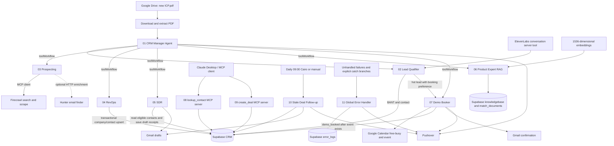

# AccountAI CRM voice-agent capstone

Eleven importable n8n workflows implement an AccountAI CRM manager, voice qualification, prospect research, CRM upserts, outreach drafts, product retrieval, demo booking, MCP tools, follow-ups, and centralized error reporting. The migration creates the CRM and 1536-dimensional product vector store in Supabase.

The files are inactive templates. Connect credentials, apply the migration, and complete the setup below before publishing triggers. Local validation does not establish that your external accounts, OAuth scopes, model route, or endpoints work.

All chat nodes use the requested default **`meta-llama/llama-3.3-70b-instruct`** through OpenRouter. That bare model ID is **not a guaranteed free route**. For zero chat-model spend, select a currently available free model that supports tool calls and structured output in every chat node. Free availability and rate limits change. The separate `text-embedding-3-small` embedding API can incur charges, as can ElevenLabs, Firecrawl, Hunter, and other services.

## Architecture



The manager normally researches an ICP, saves each supported contact through RevOps, then calls SDR once for the saved contact IDs. Qualification requires actual conversation evidence; booking requires a supplied booking preference. Product questions use the retrieval tool. System prompts bound inputs, restrict unsupported claims, and specify stopping conditions.

## Files and interfaces

| File | ID | Input / result |
|---|---|---|
| [01-crm-manager.json](workflows/01-crm-manager.json) | `capstone01` | Drive `ICP.pdf`, or sub-workflow `{text}`; six tools and structured summary |
| [02-lead-qualifier.json](workflows/02-lead-qualifier.json) | `capstone02` | `{message, contact_name, contact_email, contact_phone?, preferred_date?, conversation_id?, request_id?}`; persisted BANT result and `speech` |
| [03-prospecting.json](workflows/03-prospecting.json) | `capstone03` | `{query, limit?}`; `{success, prospects, count}`; limit 1–10, default 5 |
| [04-revops.json](workflows/04-revops.json) | `capstone04` | `{lead_description}`; `{success, contact_id, company_id}` |
| [05-sdr.json](workflows/05-sdr.json) | `capstone05` | `{limit?, contact_ids?}`; draft counts and individual results; limit 1–50, default 20 |
| [06-product-expert-rag.json](workflows/06-product-expert-rag.json) | `capstone06` | `{question}`; `{success, answer, speech, grounded, sources}` |
| [07-demo-booker.json](workflows/07-demo-booker.json) | `capstone07` | `{contact_id, preferred_date, deal_id?}`; booking slot/event or a structured failure |
| [08-mcp-lookup-contact.json](workflows/08-mcp-lookup-contact.json) | `capstone08` | Tool `lookup_contact`: `{name? , email?}`; matching contacts, company, latest qualification |
| [09-mcp-create-deal.json](workflows/09-mcp-create-deal.json) | `capstone09` | Tool `create_deal`: `{contact_email, title, value?, request_id?}`; persisted deal |
| [10-stale-deal-followup.json](workflows/10-stale-deal-followup.json) | `capstone10` | Manual or daily schedule; up to 100 stale open deals, draft summary |
| [11-global-error-handler.json](workflows/11-global-error-handler.json) | `capstone11` | Error Trigger or explicit sub-workflow error payload; logging/notification receipt |

`contact_ids` in workflow 05 is a **string containing a JSON UUID array**. An omitted/empty string searches all eligible contacts up to the limit; the string `"[]"` intentionally selects no contacts. Generic caught failures return `success:false`; optional Hunter failure preserves the original prospect and adds a warning.

Supporting files: [supabase-schema.sql](supabase-schema.sql), [assets/ICP.pdf](assets/ICP.pdf), [PROJECT-PLAN.md](PROJECT-PLAN.md), validation scripts/reports, and offline behavior tests. No API keys or exported credential IDs are embedded in the workflows.

## Supabase migration

1. Use a Supabase project with the pgvector extension available. Open its SQL Editor and run **all** of [supabase-schema.sql](supabase-schema.sql) as the project database administrator. The script wraps changes in a transaction and installs `vector` in `extensions` when needed.
2. The script is repeatable against the schema it creates. It does not automatically upgrade arbitrary pre-existing CRM tables: `CREATE TABLE IF NOT EXISTS` does not add missing columns. For an older schema, compare definitions and apply a deliberate migration, or use a new capstone project. An existing compatible Week 2 `knowledgebase` can be retained.
3. Create an n8n **Supabase API** credential with the project root URL, without `/rest/v1`, and its backend service-role/secret key. Set `SUPABASE_URL` to that same root URL, without a trailing slash. Use this credential on the Supabase vector node and on HTTP Request nodes with predefined credential type `supabaseApi`.
4. Verify all six tables and the RPCs below exist. The migration enables RLS, denies anonymous/authenticated access to these CRM tables and RPCs, and grants backend access to `service_role`. This implementation expects trusted n8n server credentials, not browser access.

| Table | Purpose |
|---|---|
| `companies` | Company data; normalized domain or normalized-name fallback deduplication |
| `contacts` | Person, company foreign key, source, lifecycle status, outreach draft receipt |
| `deals` | Contact/company foreign keys, sales stage, booking receipt, follow-up receipt, idempotency key |
| `qualification_logs` | Contact foreign key, transcript summary, four integer BANT scores, generated sum/category |
| `error_logs` | Workflow, node, execution ID, bounded error message, timestamp |
| `knowledgebase` | Document content, metadata, `vector(1536)` embedding |

Scores are 1–5 each. SQL computes the sum and category: **14–20 hot**, **8–13 warm**, **4–7 cold**. Workflows do not insert into the generated columns. Qualification updates contact status to qualified/nurture/cold while preserving existing customer status.

RPCs used by the workflows are `upsert_crm_contact`, `record_qualification`, `ensure_qualified_deal`, `finalize_demo_booking`, `lookup_crm_contact`, `create_crm_deal`, `get_stale_deals`, and `match_documents`. CRM writes requiring multiple related changes run transactionally. `match_documents(query_embedding, match_count, filter)` uses cosine similarity and JSON metadata containment; ingestion and retrieval must use the same embedding model and dimensionality.

Timestamp triggers track CRM changes. Updating only a deal's follow-up draft receipt does **not** refresh sales activity. Stale selection requires `updated_at < now() - interval '3 days'`, stage outside won/lost, a contact email, and no follow-up draft since the latest activity.

## n8n import and configuration

The exports target **n8n 2.44.6**, whose installed node definitions were inspected during development. Use this version or a compatible later release. These workflows use native n8n nodes and the bundled LangChain nodes; no community package is required.

From the workspace root, import into the intended n8n instance's data directory/project:

```powershell
n8n import:workflow --separate --input="D:\Dev\N8N\capstone\workflows"
```

The CLI imports the embedded IDs `capstone01` through `capstone11`. Import into a clean project or check for those IDs first; re-importing the same IDs updates the corresponding workflows. For installations using multiple projects, supply the target project option supported by your n8n CLI. Ensure the CLI and running editor use the same database and `N8N_USER_FOLDER` configuration.

Importing with the editor's file-import UI can assign new IDs. In that case reselect:

- All six `toolWorkflow` targets in workflow 01: workflows 02–07.
- `Call Demo Booker` in workflow 02: workflow 07.
- The `lookup_contact` tool in workflow 08: workflow 08 itself; the `create_deal` tool in workflow 09: workflow 09 itself. These calls enter the separate Execute Workflow Trigger implementation branch.
- Every explicit error-logging Execute Workflow node: workflow 11.
- **Settings → Error Workflow** on workflows 01–10: workflow 11. Workflow 11 deliberately has no error workflow.

Select credentials in each node and save. In n8n releases with publishing, publish the current version after changes. Enable/publish production triggers only after setup: workflow 01 for Drive, workflow 02 for the voice endpoint, workflows 08–09 for MCP, and workflow 10 for the daily schedule. Sub-workflows 03–07 are called through their Execute Workflow Triggers; workflow 11 is selected as the error handler. All exports begin inactive.

| Credential | Nodes / configuration |
|---|---|
| OpenRouter API | Every chat model node; select a compatible model route |
| Supabase API | CRM HTTP nodes and RAG vector store; project URL and backend key |
| OpenAI API | Workflow 06 embedding node; also the separate ingestion workflow |
| Google Drive OAuth2 | Workflow 01 trigger/download; access to the ICP folder |
| Gmail OAuth2 | Workflow 05/10 draft creation and workflow 07 confirmation sending |
| Google Calendar OAuth2 | Workflow 07 availability, existing-event lookup, event creation |
| Pushover API | Workflows 01/07/10/11; application token in credential, user key via environment |
| HTTP Header Auth | Workflow 02 webhook; e.g. header `X-AccountAI-Secret` with a shared secret configured in ElevenLabs |
| HTTP Bearer Auth | Workflow 03 Firecrawl MCP client; token expected by that endpoint |
| HTTP Bearer Auth | Workflows 08/09 MCP triggers; matching token supplied by Claude Desktop |
| HTTP Query Auth, optional | Hunter node in workflow 03; parameter name `api_key`, value your Hunter key |

The voice bridge uses an incoming ElevenLabs server tool. It does not call the ElevenLabs API, place calls, or need an `xi-api-key` credential in n8n. ElevenLabs handles transcription and speech in its own agent configuration.

Set these environment values for the n8n service, then restart it. For task runners hosted separately, provide required values in the runner environment as well. If your n8n deployment blocks `$env` access, allow it for this trusted self-hosted workflow deployment (`N8N_BLOCK_ENV_ACCESS_IN_NODE=false`), or replace these expressions with your deployment's configuration mechanism.

| Variable | Value / default |
|---|---|
| `SUPABASE_URL` | Required project root, e.g. `https://PROJECT.supabase.co`, no trailing slash |
| `ICP_FOLDER_ID` | Google Drive folder ID containing new `ICP.pdf` uploads |
| `PUSHOVER_USER_KEY` | Pushover recipient user/group key |
| `FIRECRAWL_MCP_URL` | Streamable HTTP endpoint exposing `firecrawl_search` and `firecrawl_scrape` |
| `HUNTER_ENABLED` | Optional; only exact `true` enables enrichment; otherwise skipped |
| `CALENDAR_ID` | Optional; defaults to `primary` |
| `BOOKING_TIMEZONE` | Optional; defaults to `Africa/Cairo` |

Use the Firecrawl endpoint/authentication format supplied by your deployment. The exported MCP client uses streamable HTTP and Bearer Auth. If your hosted endpoint encodes authentication in a URL instead, configure that endpoint and the corresponding auth mode deliberately; do not assume all Firecrawl deployments share one URL. The selected tools are restricted to search and scrape.

Google OAuth credentials must grant the operations used and the connected account must have access to the selected folder/calendar. A reachable HTTPS n8n production webhook base URL is required for ElevenLabs and remote MCP clients; reverse proxies must forward the MCP path and support streaming responses.

## Product knowledge ingestion

Reuse [the existing ingestion export](../workflows/02-product-rag-ingest.json), using [week2/Products.xlsx](../week2/Products.xlsx) as its source:

1. Upload/convert `Products.xlsx` to Google Sheets. Import the existing ingestion workflow separately and replace `YOUR_SPREADSHEET_ID`, select the sheet, and select Google Sheets, Supabase, and OpenAI credentials.
2. The export connects `Get products from Google Sheets` **main → Supabase Vector Store main**. If you imported an older copy, replace its main connection to `Default Data Loader` with this connection; the loader is an AI subnode. Keep `Default Data Loader` **ai_document → Supabase Vector Store** and `Embeddings OpenAI` **ai_embedding → Supabase Vector Store**.
3. Use table `knowledgebase`, insert mode, and `text-embedding-3-small` at **1536 dimensions**. Run the capstone SQL first; no separate older schema migration is necessary.
4. Run ingestion and verify rows have content and embeddings. Then execute workflow 06 with a question answerable from the sheet. For meaningful source labels, add document metadata such as product name/source to ingestion. Re-running an insert-only ingestion can duplicate documents; rebuild or deduplicate a chosen source intentionally.

Workflow 06 attaches the Supabase store in `retrieve-as-tool` mode and uses `match_documents`. Unsupported questions must produce `grounded:false` and a plain-language explanation of missing evidence. A blank or unrelated knowledge base is not a successful retrieval test.

## ElevenLabs voice bridge

In the ElevenLabs conversational agent, add a server/webhook tool that POSTs JSON to the production URL shown by workflow 02, typically `https://N8N-HOST/webhook/accountai-qualify`. Configure the exact header name/value matching the n8n webhook's Header Auth credential. Use the test URL only while n8n is listening for a test event.

Declare tool fields for `message`, `contact_name`, and `contact_email`, plus optional `contact_phone`, `preferred_date`, `conversation_id`, and `request_id`. Send cumulative relevant conversation evidence in `message` because the workflow does not persist conversational model memory. Direct ElevenLabs to speak the returned **`speech`** field, not the entire JSON object. Set a tool timeout that accommodates the model and CRM calls.

`request_id` identifies one tool invocation: reuse it for a retry of the same request and choose a new ID for a new conversational turn. `conversation_id` is context, not a deduplication key. Only include `preferred_date` after the prospect requests a booking near that preference. A hot lead without a preference gets a saved deal and a spoken request for a suitable time. This endpoint is a conversational tool, not an ElevenLabs signed post-call webhook.

Booking checks the next **five Monday–Friday business days**, including today when applicable, between **09:00 and 17:00** in `BOOKING_TIMEZONE`. Slots last 30 minutes and require at least 30 minutes notice. `preferred_date` must be a date in that window or an ISO datetime with an explicit offset. Holidays count as unavailable only when blocked in Calendar. Calendar sends an attendee invitation; Gmail sends the separate confirmation.

## Claude Desktop MCP tools

Publish workflows 08 and 09, select Bearer Auth on both triggers, and copy each production MCP URL from n8n. Typical endpoints are `/mcp/accountai-lookup-contact` and `/mcp/accountai-create-deal`; use the actual URLs shown by your instance. The server trigger has tools connected via `ai_tool`; it is not a normal main-channel webhook.

For a Claude Desktop installation using local stdio MCP configuration, [mcp-remote](https://www.npmjs.com/package/mcp-remote) bridges to the remote HTTP endpoint. This Windows example uses environment expansion to avoid spaces being mangled in command arguments:

```json
{
  "mcpServers": {
    "accountai_lookup": {
      "command": "npx.cmd",
      "args": ["-y", "mcp-remote", "https://N8N-HOST/mcp/accountai-lookup-contact", "--header", "Authorization:${ACCOUNT_AI_MCP_AUTH}"],
      "env": {"ACCOUNT_AI_MCP_AUTH": "Bearer REPLACE_WITH_TRIGGER_TOKEN"}
    },
    "accountai_deals": {
      "command": "npx.cmd",
      "args": ["-y", "mcp-remote", "https://N8N-HOST/mcp/accountai-create-deal", "--header", "Authorization:${ACCOUNT_AI_MCP_AUTH}"],
      "env": {"ACCOUNT_AI_MCP_AUTH": "Bearer REPLACE_WITH_TRIGGER_TOKEN"}
    }
  }
}
```

On macOS/Linux use `npx` instead of `npx.cmd`. Keep real tokens in local client configuration or inherited environment, outside this repository. Restart Claude Desktop after updating its MCP configuration and confirm `lookup_contact` and `create_deal` appear. If your client supports authenticated remote HTTP MCP directly, use that capability instead of the stdio bridge. An ordinary unauthenticated GET is not a complete MCP test.

`lookup_contact` accepts email or name; email is preferred for unambiguous matching. `create_deal` requires an existing CRM contact email. Supply `request_id` for retry-safe deal creation; a replay with changed fields must be rejected rather than silently changing a prior deal.

## Test payloads and expected checks

For Execute Workflow Trigger inputs, use a temporary test harness with Manual Trigger → Edit Fields/Code → Execute Sub-workflow, or call from the manager/MCP client. Select the target workflow and map its declared input fields. The samples use fictional records; copy actual returned UUIDs where indicated.

**04 RevOps first:**

```json
{"lead_description":"Mona Ali, Finance Director at Example Accounting Ltd. Email mona@example.com. Company website https://example.com, domain example.com, industry accounting, size 50-100. Source outbound."}
```

Expect `success:true` and UUIDs. Repeat it and verify the same contact/company IDs. Updating an existing qualified/customer contact must preserve its lifecycle status.

**03 Prospecting:**

```json
{"query":"Find named finance leaders at UK accounting firms with 20-100 employees. Use public company team pages and include source URLs; leave unknown email null.","limit":2}
```

Expect supported contacts or an empty array. Results must include URLs actually observed in Firecrawl responses. Unsourced emails are removed. With `HUNTER_ENABLED=true`, only confident Hunter results fill missing emails; API failures produce warnings without discarding the sourced prospect.

**02 Qualification, without booking:**

```json
{"message":"I am the finance director and final decision maker. We have approved an annual budget of 12000 dollars. Our team urgently needs to replace manual accounting spreadsheets and plans to decide within two weeks. I would like to discuss a demo, but I have not chosen a time yet.","contact_name":"Mona Ali","contact_email":"mona@example.com","conversation_id":"capstone-conversation-1","request_id":"capstone-qualification-turn-1"}
```

Expect four 1–5 scores, a SQL-computed category, saved contact/log, and spoken response. This strong-evidence sample should qualify highly, but model scores are not deterministic. Test precise score boundaries with the database test rather than assuming exact LLM numbers. Also test weak interest/missing evidence and medium-fit evidence for cold/warm handling. Replay the same `request_id` and verify it does not add another qualification log.

To call the voice endpoint from PowerShell after setting a local secret variable:

```powershell
$payload = @{ message = 'I am evaluating accounting tools but have no budget or timeline yet.'; contact_name = 'Mona Ali'; contact_email = 'mona@example.com'; request_id = 'capstone-qualification-turn-2' }
Invoke-RestMethod -Method Post -Uri 'https://N8N-HOST/webhook/accountai-qualify' -Headers @{ 'X-AccountAI-Secret' = $env.ACCOUNTAI_VOICE_SECRET } -ContentType 'application/json' -Body ($payload | ConvertTo-Json)
```

**05 SDR:**

```json
{"limit":1,"contact_ids":"[\"REPLACE_WITH_CONTACT_UUID\"]"}
```

Use a new/qualified contact whose `outreach_drafted_at` is null. Expect one Gmail draft with the CRM recipient and a saved receipt. Repeat and expect no new draft. Test `{"contact_ids":"[]"}` and verify zero drafts and no broad CRM scan result.

**06 Product Expert:**

```json
{"question":"Which products in the imported catalogue support invoicing, and what does the catalogue say about their pricing?"}
```

Compare each claim with the ingested catalogue. Also ask a question absent from it and verify an explicit missing-information answer with `grounded:false`.

**07 Demo Booker:**

```json
{"contact_id":"REPLACE_WITH_CONTACT_UUID","preferred_date":"REPLACE_WITH_NEXT_BUSINESS_DATE","deal_id":"REPLACE_WITH_ACTIVE_DEAL_UUID"}
```

Use `YYYY-MM-DD` within the next five business days, or an offset datetime such as `YYYY-MM-DDT10:00:00+02:00` with the actual offset for that date. Omit `deal_id` to let the workflow obtain the active qualified deal. This test creates a Calendar event, sends invitations and a Gmail confirmation, updates CRM, and sends Pushover. Verify a genuinely busy slot is excluded, event start matches the selected slot, and CRM becomes `demo_booked` only after the event exists. Replay and verify the existing deterministic event is reused without repeating the confirmation. An entirely blocked calendar should return no availability.

**08 Lookup tool:**

```json
{"email":"mona@example.com"}
```

Or `{"name":"Mona Ali"}`. Check that company and latest qualification accompany the correct contact and that no match returns an empty result.

**09 Create-deal tool:**

```json
{"contact_email":"mona@example.com","title":"AccountAI evaluation","value":12000,"request_id":"capstone-deal-request-1"}
```

Verify a repeated identical request returns the same deal. A new request ID creates a distinct request; changed payload with the old key and unknown contact email must fail clearly.

**10 Stale follow-up:** create a test open deal, then backdate only that fixture in the SQL Editor:

```sql
UPDATE public.deals
SET updated_at = now() - interval '4 days',
    followup_drafted_at = NULL, followup_draft_id = NULL
WHERE id = 'REPLACE_WITH_TEST_DEAL_UUID'::uuid;
```

Run `Manual Trigger`. Verify one draft/receipt and Pushover summary. Repeat unchanged and verify no duplicate. Closed won/lost deals must be excluded. No eligible deals should take the silent branch. Workflow 10's schedule is daily at 09:00 Africa/Cairo and runs only when published/enabled.

**11 Error handler, explicit invocation:**

```json
{"workflow_name":"Capstone smoke test","node_name":"Simulated failure","execution_id":"manual-test-1","error_message":"Intentional test error; token=must-be-redacted"}
```

Verify a redacted `error_logs` row and Pushover receipt. Also test n8n's Error Trigger shape:

```json
{"workflow":{"id":"capstone01","name":"01 - CRM Manager"},"execution":{"id":"manual-test-2","lastNodeExecuted":"CRM Manager Agent","error":{"message":"Intentional model failure"}}}
```

An Error Trigger normally runs for failed production executions, not every editor test or handled error. Explicit catch branches invoke workflow 11 directly so those failures are still logged. If Supabase logging fails, the alert path still attempts Pushover; if Pushover fails, the returned receipt reports that failure without recursive error handling.

**01 Full run:** upload a new file named exactly `ICP.pdf` to the watched folder after publishing the Drive trigger. Use [assets/ICP.pdf](assets/ICP.pdf). Alternatively call its `Run with ICP Text` trigger with `{"text":"Find two named finance leaders at small accounting firms using public evidence."}`. Verify the six tool links, research/upsert/draft sequence, scoped SDR IDs, and final summary against actual records and drafts.

## Fifteen-skill verification matrix

| # | Skill | Concrete implementation | Verification |
|---|---|---|---|
| 1 | AI agents with tool-calling loops | 01 `CRM Manager Agent`; sub-agent Agent nodes | Inspect tool calls and bounded iteration settings |
| 2 | Sub-workflows as tools | 01 six `toolWorkflow` nodes targeting 02–07 | All six use `ai_tool`; inputs match child triggers |
| 3 | ElevenLabs voice integration | 02 `ElevenLabs Webhook` / `Respond to ElevenLabs` | Authenticated POST returns spoken `speech` |
| 4 | Structured Output Parser | 02 BANT parser; 04 RevOps parser | Invalid scores/fields rejected before CRM writes |
| 5 | Supabase RAG | 06 `product_knowledge_base` + 1536 embeddings | Known question retrieves evidence; unknown question reports missing facts |
| 6 | MCP Server Trigger | 08/09 `MCP Server Trigger` and attached workflow tool | MCP client lists and invokes lookup/create tools |
| 7 | MCP Client | 03 `Firecrawl MCP Client` | Search/scrape tool results support returned source URLs |
| 8 | Google Drive Trigger | 01 `Watch ICP File Drop` → PDF download/extract | New `ICP.pdf` starts manager; other files excluded |
| 9 | Google Calendar | 07 five-day free-busy, final check, event creation | Busy slots excluded; confirmed event precedes CRM stage change |
| 10 | Gmail | 05 outreach drafts; 10 follow-up drafts; 07 confirmation | Draft IDs saved; booking confirmation follows persisted event |
| 11 | HTTP Request | 03 Hunter; Supabase RPC calls; 07 event lookup | Authenticated request/response contracts and optional fallback |
| 12 | If/Switch branching | 02 hot/warm/cold If nodes; 01 success/failure | 7/8/13/14 category boundaries; catch path returns failure |
| 13 | Scheduled trigger | 10 `Daily at 09 Cairo` plus manual entry | Both reach the same stale-deal query |
| 14 | Local/global error handling | Native error outputs + explicit workflow 11 calls + `settings.errorWorkflow` | Logs and alert receipts; handler has no recursive error workflow |
| 15 | Context engineering | Agent system prompts, parsers, input limits, scoped tool descriptions | Evidence rules, minimal context, bounded calls, no invented claims |

## Validation and recovery

Run the local checks from the workspace root:

```powershell
node capstone/scripts/validate-workflows.cjs
node capstone/tests/outbound-behavior.cjs
node capstone/scripts/test-database.cjs
```

The workflow validator checks the exports, node positions, connection channels, code/parser syntax, shared workflow references and installed node definitions. [workflow-validation.json](validation/workflow-validation.json) records its result. [database-validation.json](validation/database-validation.json) records execution of the **unmodified migration twice** on PostgreSQL 18.6 through PGlite 0.5.11 with pgvector and simulated Supabase roles. Its 13 checks cover upserts, BANT boundaries, transaction rollback, replay protection, booking ownership, stale tracking, vector ranking/filtering, and denied anonymous access. The outbound behavior test covers evidence validation, safe scope/recipient handling, optional enrichment failures and partial result counts. Runtime dependencies for the database check are described in its script; the migration itself is intended for Supabase.

These are local structural and behavioral checks. External OpenRouter/embedding calls, hosted Supabase/PostgREST, Google OAuth/Calendar/Gmail, Firecrawl, Hunter, ElevenLabs, MCP client connectivity and Pushover require the configured-account smoke tests above. No live credentials or end-to-end external-service success are claimed by the exported templates.

Run only one draft or booking execution at a time for a shared contact/calendar. Supabase transactions cannot atomically include Gmail or Google Calendar writes. Draft receipt markers prevent ordinary repeat runs, but a crash after Gmail creates a draft and before its receipt is saved requires checking Gmail and reconciling the CRM marker before retrying. A stale-deal activity change during draft creation also requires review. Booking uses deterministic event IDs and an existing-event lookup to recover a previously created event; a final availability check reduces conflicts but does not provide a cross-deal Calendar lock. Errors after an event exists include recovery context where available. Avoid blindly retrying external side effects.
